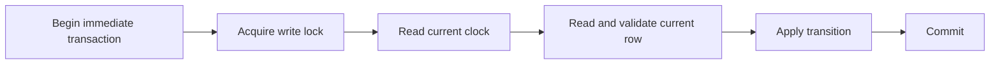

# When a lease starts: time belongs inside the transaction

RelayBox uses SQLite transactions to give one worker a current lease. A code
review of the initial implementation found that sampling the clock before
waiting for the write lock could invalidate that guarantee. The correction and
its deterministic regression tests shipped in
[616d270](https://github.com/ult666666/relaybox/commit/616d270bfba2cd5562b80b61b9f993b89593f5a1).

This is a local educational system and a synthetic test scenario. These logical
timestamps describe the failure; they are not measured throughput or production
incident data.

## The failure

A transaction may wait for another connection to release SQLite's write lock.
If it captures `now` before that wait, it makes a decision using an earlier
instant than the state it eventually reads.

| Operation | Clock sampled before the lock | Lock acquired | Incorrect result |
| --- | --- | --- | --- |
| Claim a 30-second lease | 100 | 140 | Deadline 130 is already expired |
| Acknowledge a lease ending at 130 | 100 | 140 | Expired owner passes the stale time check |
| Schedule a 2-second retry | 100 | 140 | Retry time 102 is already in the past |

The mutex-like effect of a write transaction does not make the earlier clock
sample current. Token equality alone also cannot establish that a lease remains
unexpired.

## The corrected order



`claim`, completion, ingest and replay sample their clock after
`BEGIN IMMEDIATE` has acquired the write lock. A completion checks both the
current token and `lease_until > now` inside that same transaction. Equality
with the deadline is expired.

This places the time-sensitive decision beside the state it governs. The
operation still depends on a sensible local clock and SQLite's local filesystem
behavior; it does not create a distributed clock or fence another database.

## Reproduce the evidence

From a RelayBox checkout with Python 3.11+:

```sh
python3 -m unittest tests.test_store.StoreTests.test_claim_lease_starts_after_waiting_for_write_lock -v
python3 -m unittest tests.test_store.StoreTests.test_ack_waiting_for_write_lock_cannot_complete_expired_lease -v
python3 -m unittest tests.test_store.StoreTests.test_failure_backoff_starts_after_waiting_for_write_lock -v
```

The tests use a real second SQLite connection, explicit synchronization and a
controlled clock. They advance logical time while the target operation waits,
then inspect the persisted transition. An arbitrary sleep would make this a
scheduling guess; the tests instead coordinate the specific lock boundary.

Read the [test implementation](https://github.com/ult666666/relaybox/blob/main/tests/test_store.py)
beside the [state machine](https://github.com/ult666666/relaybox/blob/main/relaybox/store.py).
The initial fix added seven contention regression cases. They failed against the
earlier implementation and passed after the ordering correction.

## The remaining boundary

A worker that lost its lease may already have completed an external side effect.
Rejecting its acknowledgment protects the inbox's current state; it cannot undo
that effect. Consumers still need an idempotency strategy for their own systems.
That distinction is why the portfolio describes at-least-once processing and
explicit recovery.

Implementation and this write-up were developed with AI assistance. The claim is
limited to the source and recorded checks above.
